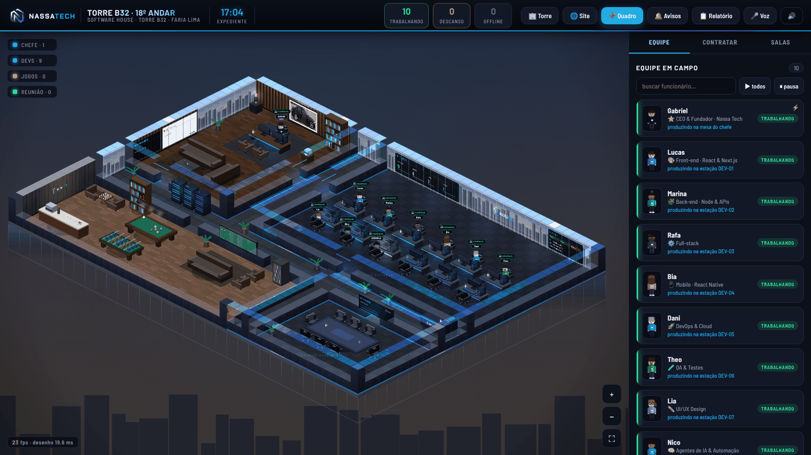

# Nassa Tech · Escritório

O escritório da **Nassa Tech** no navegador, em estilo Habbo (isométrico),
montado num andar de uma torre de vidro na Faria Lima, inspirada no
**prédio da baleia** (Torre B32). A empresa é de tecnologia, focada em
programação, e o escritório foi pensado como o de uma software house de
verdade.



## O que tem no andar

| Sala | O que tem |
| --- | --- |
| **Sala do chefe** | A mesa do Gabriel, painel ripado de madeira, o **quadro da BMW 335i E90 M Sport LCI (2009/2010)** preta com as rodas **Style 359M de 19" prata**, poltronas de couro para visitas, estante, estar com sofá de couro, máquina de café e vista para a Ponte Estaiada |
| **Sala dos devs** | 12 estações com monitor, painel com a equipe ao vivo, quadro de **CI/CD** (build, test, deploy) e o logo jateado no vidro da fachada |
| **Sala de reunião** | Aquário de vidro com mesa para oito e telão com o logo. É onde acontecem a daily e a reunião dos agentes |
| **Sala de jogos** | Um lounge sóbrio, sem luz colorida: assoalho claro, painel de feltro grafite com o logo em metal, sinuca com luminária pendente, pebolim, mesa de xadrez, videogame no telão, poltronas de couro, balcão de café e geladeira de bebidas |
| **Recepção** | Hall dos elevadores, balcão com o logo e o rack dos servidores |

O prédio tem características reais:

- **Fachada de pele de vidro:** as paredes norte e oeste são janelas do chão
  ao teto. Por elas aparecem as torres da Faria Lima e do Itaim, a Ponte
  Estaiada sobre o Rio Pinheiros e os helipontos com a luz vermelha no topo.
  O céu muda com a hora do relógio (dia, pôr do sol e noite).
- **Laje e andar de baixo:** a borda do piso mostra a laje de concreto e a
  fachada de vidro descendo, então o escritório aparece como uma fatia da
  torre.
- **Tela de entrada (botão 🏢 Torre):** a torre vista da avenida, com 24
  andares, o prédio baixo do teatro com teto verde, a praça aberta com a
  **escultura da baleia** e a Faria Lima com a ciclovia vermelha. O 18º andar,
  o da Nassa Tech, fica aceso.
- **Pisos reais:** madeira escura na sala do chefe, madeira clara na sala de
  jogos, carpete em placas nos devs e na reunião e porcelanato na circulação.

### O quadro da BMW

Atrás da mesa do chefe fica o quadro da **BMW 335i E90 M Sport LCI
(2009/2010)** preta, com as rodas **Style 359M de 19" prata**, em pixel art
(`assets/bmw-e90-335i.webp`). O quadro tem moldura preta, paspatur, luminária
de galeria e plaqueta dourada. Clique nele para abrir a versão grande. Uma
miniatura da mesma foto fica num porta-retrato da estante.

Para trocar a foto, substitua `assets/bmw-e90-335i.webp` por outra imagem com
o carro de lado. O recorte do quadro (`CARRO` em `js/bmw.js`) mantém o carro
inteiro.

### Logo

A logo está em PNG na pasta `assets/`:

| Arquivo | Uso |
| --- | --- |
| `assets/nassatech-logo.png` | a original, com o fundo escuro |
| `assets/nassatech-logo-transparente.png` | fundo transparente, para usar sobre fundo escuro (topo, vidro, telão, recepção) |
| `assets/nassatech-icone.png` | só o "N", com fundo transparente |
| `assets/nassatech-icone-180.png` e `favicon.png` | ícone do navegador e do celular |

## Começar

Precisa do [Node.js](https://nodejs.org) 18 ou mais novo. Não tem dependência
para instalar.

```bash
git clone <url-deste-repositório> escritorio-ia
cd escritorio-ia
npm start
```

Abra **http://localhost:4321**. Na primeira visita da sessão aparece a torre
vista da rua: clique em **▲ Subir para o escritório**. Para pular a entrada,
abra `http://localhost:4321/?direto`.

No Windows:
- **`INICIAR ESCRITORIO.cmd`** sobe o escritório e o religa se ele cair.
- **`CRIAR ATALHO.ps1`** cria um atalho na área de trabalho. Para rodar: botão
  direito no arquivo e depois **Executar com o PowerShell**.

## A equipe

O Gabriel (CEO & Fundador) fica na sala do chefe. **O computador dele abre o
site da Nassa Tech** (https://nassatech.com.br/), que fica registrado como o
sistema `site` em `data/sistemas.json`. O site passa pelo espelho local
porque muitos sites recusam abrir dentro de um iframe.

O andar já começa com um time de software house: front-end, back-end,
full-stack, mobile, DevOps, QA, UI/UX e agentes de IA, além do agente de
exemplo. Na aba **Contratar** dá para trazer mais gente (há também uma vaga
de comercial) ou cadastrar um agente seu.

Cada funcionário pode ter um sistema de verdade por trás. Clique no
computador dele para abrir esse sistema ali mesmo:

| Sistema do agente | O que preencher |
| --- | --- |
| **Roda nesta máquina** | pasta do projeto, comando (`npm`, `node`, `python`…), argumentos (`run dev`) e uma porta livre |
| **Site / URL** | o endereço. Se o site recusar abrir em iframe, marque "usar o espelho" |
| **Nenhum** | só o boneco, sem sistema |

Por segurança, o escritório escuta só em `127.0.0.1`, executa só o que está no
registro e recusa comando com `& | ; < > $` e crase. Ele também ignora pedido
vindo de outro site aberto no navegador.

## Conversar com um agente

No monitor, **💬 Conversar** abre uma sessão do [Claude Code](https://claude.com/claude-code)
dentro da pasta do sistema:

- **Investigar** só lê e explica.
- **Resolver** pode editar o projeto.

Precisa do Claude Code instalado e logado nesta máquina.

## Reunião dos agentes

Na sala de reunião, **▶ Reunir agora** junta os agentes que têm sistema local.
Cada um lê o próprio projeto e diz três coisas:

1. um número real;
2. uma melhoria;
3. o que precisa de outro agente.

No fim, um briefing junta tudo.

Cada fala é uma chamada ao Claude e consome a cota do seu plano. Por isso o
horário automático vem **desligado**. Para ligar, e para dar uma meta à
reunião, use `data/config.json` (veja abaixo).

## Configuração

Copie `data/config.exemplo.json` para `data/config.json` e ajuste:

- `nome`, `subtitulo`: o nome da empresa e a linha de baixo no topo da tela.
- `dono`, `cargo`: o nome e o cargo do boneco da sala do chefe.
- `empresa`: uma frase sobre o negócio, que vira contexto na reunião.
- `site`: o endereço do botão 🌐 Site e da tela de entrada.
- `predio`, `endereco`, `andar`: o que aparece no topo e na fachada.
- `porta`: a porta do escritório (padrão 4321).
- `reuniao.automatica`, `dias`, `hora`: a reunião em horário fixo.
- `reuniao.meta`: `descricao`, `alvo`, `feito`, `unidade` e `ate` aparecem no
  placar e orientam a conversa.

As cores da marca (fundo `#05070D`, branco `#F2F6FF`, ciano `#00B3FF`) estão
no topo de `css/style.css` e em `js/nassa.js`.

## Avisos no celular

**🔔 Avisos** manda notificação pelo app gratuito [ntfy](https://ntfy.sh) ou
pelo WhatsApp via CallMeBot. O escritório avisa quando:

- um sistema caiu e não voltou;
- a reunião terminou;
- uma ação da agenda rodou.

Seus sistemas também podem pedir um aviso:

```http
POST http://localhost:4321/api/avisar
{ "titulo": "Meu agente", "texto": "3 pedidos esperando", "prioridade": "normal" }
```

## Agenda

`data/agenda.json` liga ou desliga um sistema numa data marcada. O exemplo está
no comentário da seção AGENDA em `server.js`.

## O que fica fora do git

Configuração, equipe, avisos (com a chave do CallMeBot), atas e estado ficam em
`data/` e são ignorados pelo git. Só os dois arquivos `*.exemplo.json` são
versionados.

## Estrutura

```
server.js          servidor: arquivos da tela, API, sobe/vigia sistemas, espelho
reuniao.js         reunião dos agentes (Claude Code em cada pasta)
avisos.js          ntfy e CallMeBot
index.html         a tela
js/nassa.js        cores da marca, vista da cidade, céu e a fachada da torre
js/bmw.js          o quadro da BMW 335i E90 M Sport LCI (foto em pixel art)
js/world.js        a planta: salas, pisos, fachada de vidro e placas
js/furniture.js    móveis e estações de trabalho
js/                o resto do motor: bonecos, caminhos, painéis
css/style.css      tema
assets/            a logo da Nassa Tech em PNG e a foto da BMW
exemplo-agente/    o menor sistema que o escritório sabe operar
data/              seus dados (fora do git, menos os exemplos)
```

## Créditos e licença

O motor isométrico vem do projeto
[Escritório de Agentes](https://github.com/a2labsnutrition/Escritorio-de-agentes),
sob licença MIT. Veja [LICENSE](LICENSE).

A Torre B32 e a escultura da baleia são marcos públicos da Faria Lima. Aqui
aparecem como ilustração de inspiração, sem ligação com o edifício.
